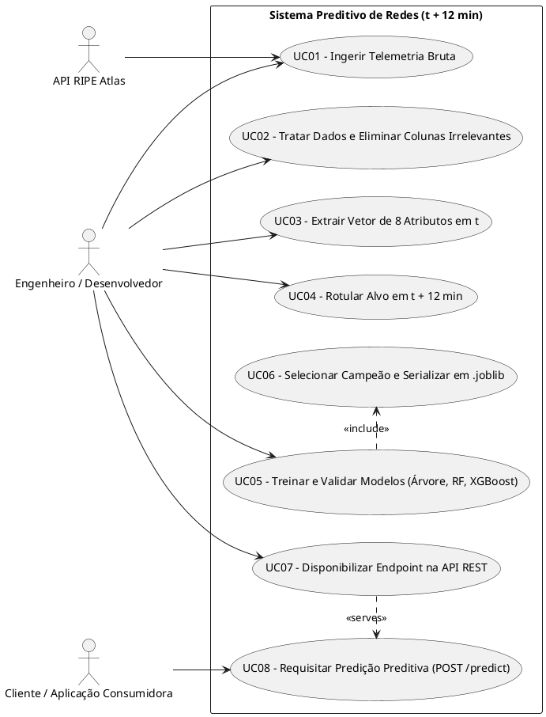
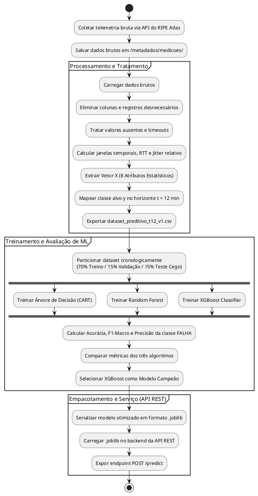
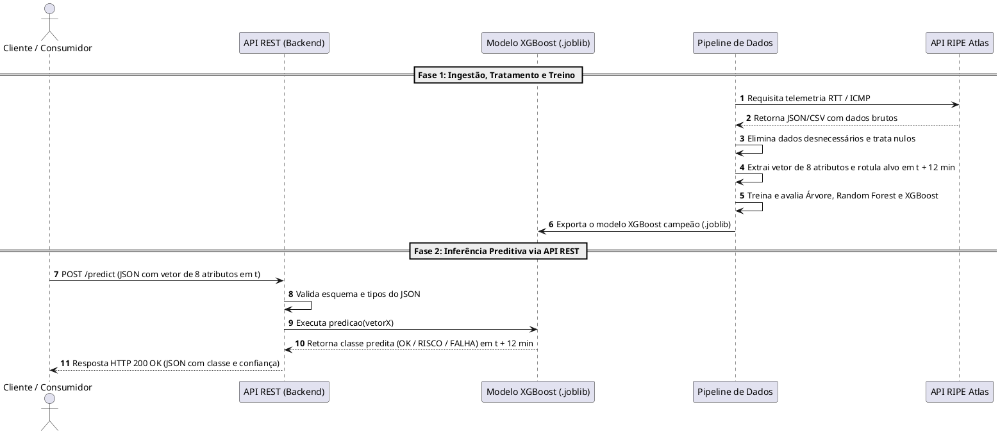

# 📐 Diagramas Técnicos da Arquitetura do Sistema

Este documento reúne a modelagem UML do projeto **Preditor de Falha e Risco em Dispositivos de Rede ($t + 12\text{ min}$)**, cobrindo desde a ingestão de telemetria bruta até ao serviço de inferência na API REST.

---

## 1. Diagrama de Casos de Uso

Mapeia as interações entre os atores (API do RIPE Atlas, Desenvolvedor/Engenheiro e Cliente Consumidor) e os casos de uso do sistema.

---

## 2. Diagrama de Atividades

Detalha o fluxo passo a passo do processamento de dados, fases de treino/validação dos modelos de Machine Learning e publicação da API.

---

## 3. Diagrama de Sequência

Demonstra a ordem cronológica de eventos dividida em duas fases: o ciclo de Ingestão/Treino e o fluxo de consumo via API REST.

