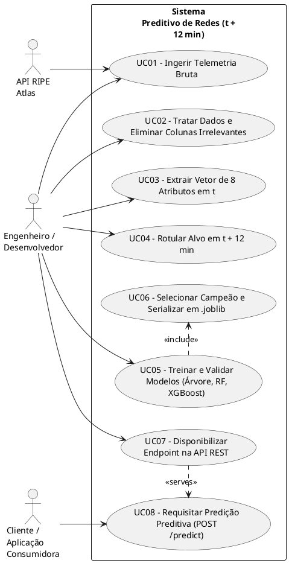
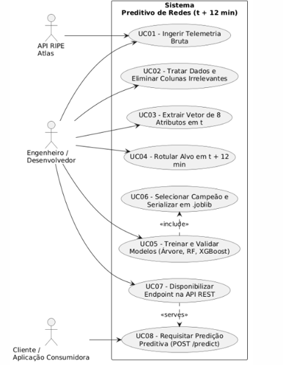
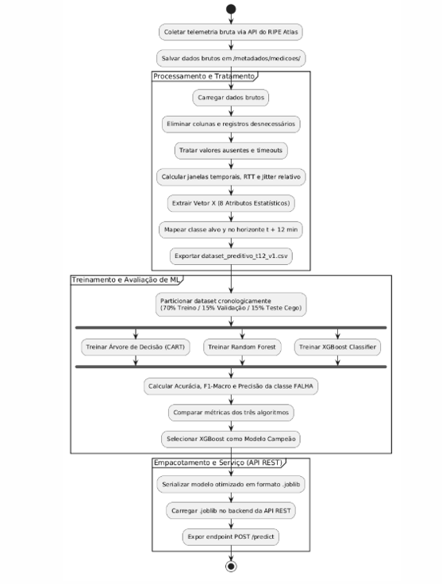
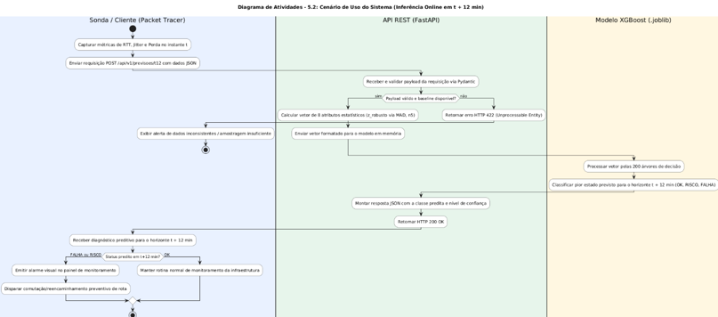
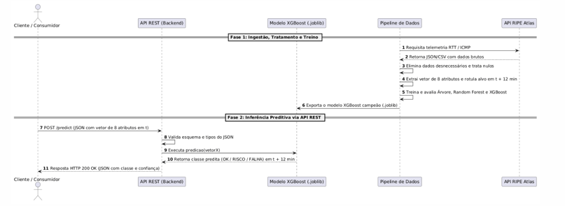
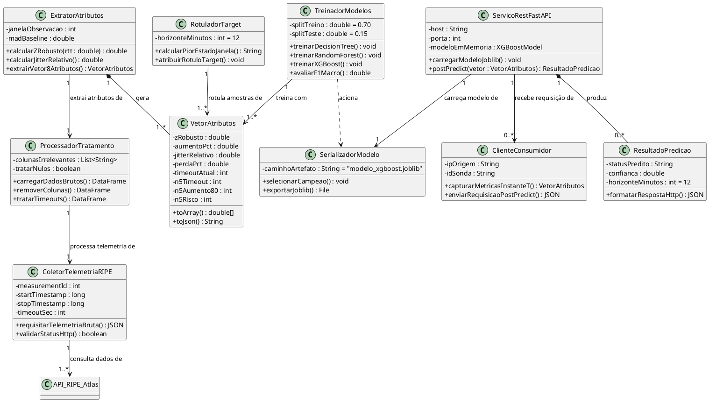
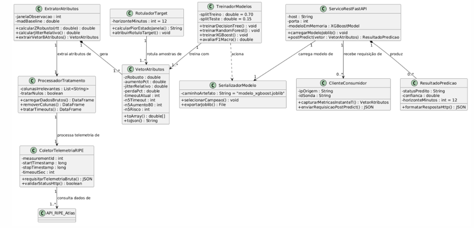

# 📐 Diagramas Técnicos da Arquitetura do Sistema

Este documento reúne a modelagem UML do projeto **Preditor de Falha e Risco em Dispositivos de Rede ($t + 12\text{ min}$)**, cobrindo desde a ingestão de telemetria bruta até ao serviço de inferência na API REST.

---

## 1. Diagrama de Casos de Uso

Mapeia as interações entre os atores (API do RIPE Atlas, Desenvolvedor/Engenheiro e Cliente Consumidor) e os casos de uso do sistema.





---

## 2. Diagrama de Atividades

Detalha o fluxo passo a passo do processamento de dados, fases de treino/validação dos modelos de Machine Learning e publicação da API.

```plantuml
@startuml
start

:Coletar telemetria bruta via
API do RIPE Atlas;
:Salvar dados brutos em
/metadados/medicoes/;

partition "Processamento
e Tratamento" {
    :Carregar dados brutos;
    :Eliminar colunas e registros
desnecessários;
    :Tratar valores ausentes e timeouts;
    :Calcular janelas temporais, RTT e Jitter
relativo;
    :Extrair Vetor X (8 Atributos
Estatísticos);
    :Mapear classe alvo y no horizonte t + 12
min;
    :Exportar dataset_preditivo_t12_v1.csv;
}

partition "Treinamento e
Avaliação de ML" {
    :Particionar dataset cronologicamente\n(70%
Treino / 15% Validação / 15% Teste Cego);
    
    fork
        :Treinar Árvore de Decisão (CART);
    fork again
        :Treinar Random Forest;
    fork again
        :Treinar
XGBoost Classifier;
    end fork

    :Calcular Acurácia, F1-Macro e Precisão da
classe FALHA;
    :Comparar métricas dos três algoritmos;
    :Selecionar XGBoost como Modelo Campeão;
}

partition "Empacotamento
e Serviço (API REST)" {
    :Serializar modelo otimizado em formato
.joblib;
    :Carregar .joblib no backend da API REST;
    :Expor endpoint POST /predict;
}

stop
@endluml
```



---

## 3. Diagrama de Atividades II: Cenário de Uso (Inferência Online em t + 12 min)

Detalha o fluxo de inferência em tempo real e ações tomadas no painel de monitoramento.

```plantuml
@startuml
title Diagrama de Atividades - 5.2: Cenário de Uso do Sistema (Inferência Online em t + 12 min)

skinparam ActivityBackgroundColor #FFFFFF
skinparam ActivityBorderColor #2B2B2B
skinparam PartitionBorderColor #4A90E2

|#E8F0FE|Sonda / Cliente (Packet Tracer)|
|#E6F4EA|API REST (FastAPI)|
|#FEF7E0|Modelo XGBoost (.joblib)|

|Sonda / Cliente (Packet Tracer)|
start
:Capturar métricas de RTT, Jitter e Perda no
instante t;
:Enviar requisição POST /api/v1/previsoes/t12
com dados JSON;

|API REST (FastAPI)|
:Receber e validar payload da requisição via
Pydantic;

if (Payload válido e baseline disponível?) then
(sim)
    :Calcular vetor de 8 atributos estatísticos (z_robusto via MAD, n5);
    :Enviar vetor formatado para o modelo em memória;
else (não)
    :Retornar
erro HTTP 422 (Unprocessable Entity);
    |Sonda
/ Cliente (Packet Tracer)|
    :Exibir alerta de dados inconsistentes / amostragem insuficiente;
    stop
endif

|Modelo XGBoost (.joblib)|
:Processar vetor pelas 200 árvores de decisão;
:Classificar pior estado previsto para o
horizonte t + 12 min (OK, RISCO, FALHA);

|API REST (FastAPI)|
:Montar resposta JSON com a classe predita e
nível de confiança;
:Retornar HTTP 200 OK;

|Sonda / Cliente (Packet Tracer)|
:Receber diagnóstico preditivo para o horizonte
t + 12 min;

if (Status predito em t+12 min?) is (FALHA ou
RISCO) then
    :Emitir alarme visual no painel de monitoramento;
    :Disparar comutação/reencaminhamento preventivo de rota;
else (OK)
    :Manter rotina normal de monitoramento da infraestrutura;
endif

stop
@endluml
```



---

## 4. Diagrama de Sequência

Demonstra a ordem cronológica de eventos dividida em duas fases: o ciclo de Ingestão/Treino e o fluxo de consumo via API REST.

```plantuml
@startuml
autonumber
actor "Cliente / Consumidor" as Client
participant "API REST (Backend)" as API
participant "Modelo XGBoost (.joblib)" as Model
participant "Pipeline de Dados" as Pipeline
participant "API RIPE Atlas" as RIPE

== Fase 1: Ingestão, Tratamento e Treino ==
Pipeline -> RIPE: Requisita telemetria RTT /
ICMP
RIPE --> Pipeline: Retorna JSON/CSV com dados
brutos
Pipeline -> Pipeline: Elimina dados
desnecessários e trata nulos
Pipeline -> Pipeline: Extrai vetor de 8
atributos e rotula alvo em t + 12 min
Pipeline -> Pipeline: Treina e avalia Árvore,
Random Forest e XGBoost
Pipeline -> Model: Exporta o modelo XGBoost
campeão (.joblib)

== Fase 2: Inferência Preditiva via API REST ==
Client -> API: POST /predict (JSON com vetor
de 8 atributos em t)
API -> API: Valida esquema e tipos do JSON
API -> Model: Executa predicao(vetorX)
Model --> API: Retorna classe predita (OK /
RISCO / FALHA) em t + 12 min
API --> Client: Resposta HTTP 200 OK (JSON
com classe e confiança)
@endluml
```



---

## 5. Diagrama de Classes

Apresenta a estrutura estática de classes do sistema, seus atributos, métodos e relacionamentos.



